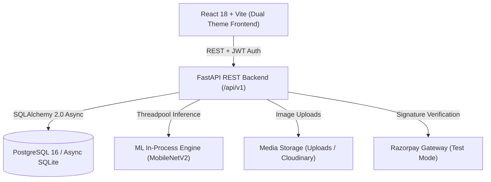

# AgriConnect — System Architecture & Component Interactions

## 1. Architectural Overview
AgriConnect employs a layered, decoupled web service architecture where the browser React application communicates exclusively with the asynchronous Python FastAPI REST backend via JSON over HTTPS. The FastAPI backend is the sole orchestrator of database transactions, ML model execution, media file storage, and payment workflows.

## 2. Key Data Flows

### 2.1 Authentication & RBAC
1. Client POSTs credentials to `/api/v1/auth/login`.
2. Backend queries user record, verifies password hash using bcrypt, and issues a signed JWT access token (15-min expiry) and refresh token (7-day expiry).
3. Client attaches `Authorization: Bearer <token>` in subsequent requests.
4. FastAPI `require_role()` dependency extracts token claims, verifies role permissions, and ensures user status is active.

### 2.2 Atomic Order Placement & Fulfillment
1. Customer initiates checkout from `/api/v1/orders`.
2. `order_service` executes an atomic database transaction:
   - Validates stock across cart line items.
   - Groups produce items by individual farmer.
   - Deducts stock from each `crop_listings` record.
   - Inserts `orders` and `order_items` preserving locked unit price.
   - Clears customer shopping cart items.
   - Logs event into `admin_logs`.
3. Farmer views incoming order, confirms fulfillment, marks shipment dispatched, and records final delivery.
4. Once delivered, customer review capabilities unlock.

### 2.3 Disease Prediction Workflow
1. Farmer uploads leaf image through `/api/v1/disease/predict`.
2. Image bytes are validated for format and size (5MB max) and preprocessed into normalized tensors `[-1, 1]` with dimensions `(224, 224, 3)`.
3. Model computes softmax probabilities across 38 PlantVillage classes via `run_in_threadpool`.
4. Backend retrieves chemical and organic treatment protocols from `disease_treatments`.
5. Diagnosis record is persisted to `disease_predictions` with geographic tags (district, state) to power the epidemiological hotspot analytics map.

## 3. Technology Stack Summary
- **Frontend**: React 18, Vite, React Router 6, TanStack Query, Axios, Tailwind CSS (with CSS variable dual theme engine), Recharts, Lucide Icons.
- **Backend**: Python 3.11+, FastAPI, SQLAlchemy 2.0 (async), Alembic, Pydantic v2, python-jose, bcrypt, Pillow.
- **Database**: PostgreSQL 16 (production/Docker) & Async SQLite (zero-setup local execution).
