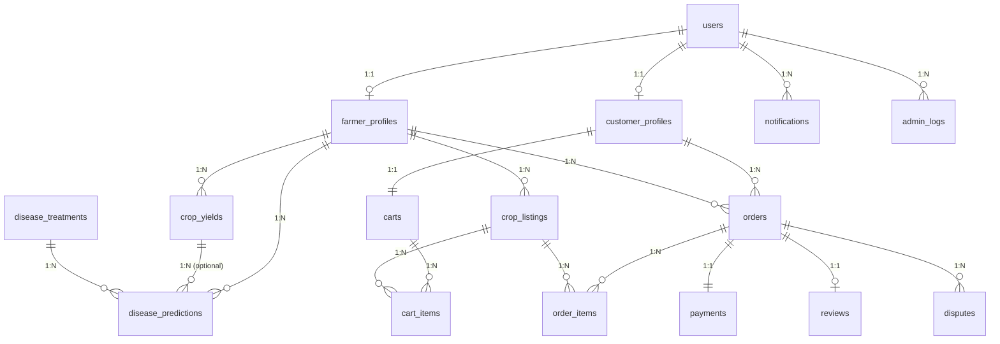

# AgriConnect — Database Design & Schema Specification

## 1. Relational Entities (16 Tables)

## 2. Table Catalog

1. **`users`**: Master authentication, role (`farmer`, `customer`, `admin`), account status (`active`, `blocked`, `pending`), timestamps.
2. **`farmer_profiles`**: Farm name, location (village, district, state, pincode), acreage, ID proof URL, land document proof URL, verification status (`pending`, `approved`, `rejected`), average rating.
3. **`customer_profiles`**: Delivery address, city, district, state, postal code.
4. **`crop_yields`**: Seasonal production records (crop name, season: `kharif`/`rabi`/`zaid`, year, sowing date, harvest date, output kg, cultivated acres, notes).
5. **`disease_treatments`**: Reference dictionary containing 38 PlantVillage classes, chemical controls, organic biocides, dosages, and prevention tips.
6. **`disease_predictions`**: Timestamped scan records with predicted class, confidence, top-3 alternatives JSON, uncertainty flag, model version, and district/state tags.
7. **`crop_listings`**: Marketplace inventory with produce name, price per kg, available quantity, quality grade (A/B/C), organic flag, and status (`active`, `paused`, `sold_out`, `removed`).
8. **`carts`**: Customer shopping basket header.
9. **`cart_items`**: Line items with listing reference and desired quantity in kg.
10. **`orders`**: Purchase orders with sequential order number, customer ID, farmer ID, fulfillment method (`delivery`/`pickup`), total amount, and status.
11. **`order_items`**: Locked historical record of items, unit price, quantity, and line total.
12. **`payments`**: Transaction records with payment method (`online`/`cod`), gateway IDs, and status (`initiated`, `paid`, `failed`, `refunded`).
13. **`reviews`**: One review per delivered order (`UNIQUE order_id`), rating 1-5, comment text, and moderation hide flag.
14. **`disputes`**: Complaint records raised on orders with admin resolution notes and status.
15. **`notifications`**: User-specific alerts and platform-wide broadcast announcements.
16. **`admin_logs`**: Immutable audit journal tracking administrative actions, user status changes, and order pipeline transitions.

## 3. Database Rules Enforced
- **Review Cardinality**: A review exists only once per order (`UNIQUE order_id`); service checks order is `delivered`.
- **Immutable Pricing**: `order_items` copies `unit_price` and `crop_name` so subsequent edits by the seller never mutate historical records.
- **Hotspot Optimization**: `disease_predictions` stores `state` and `district` directly, enabling fast geographical grouping without multi-table joins.
- **Listing Protection**: Marketplace listing operations require `verification_status == 'approved'`.
